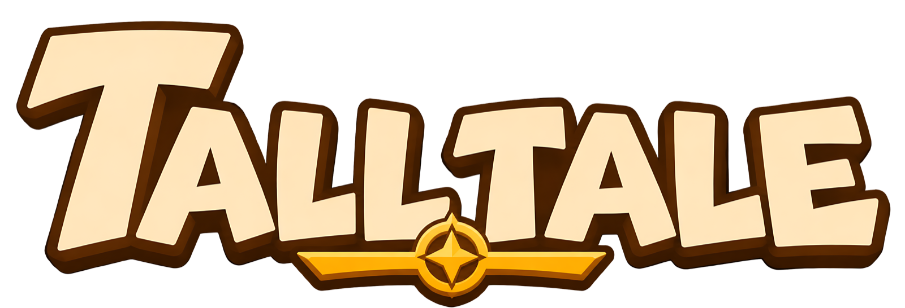

<p align="center">
  
</p>

<p align="center">
  <b>A seated, hands-only VR game for Meta Quest.</b><br />
  You are a giant in the middle of a tiny castle. Pinch goblins, eat them, and turn the war with giant tools.
</p>

<p align="center">
  <a href="https://pulkit-jasti.github.io/tall-tale/"><b>Play it now</b></a> (open the link in the Meta Quest Browser)
</p>

---

## What it is

A small kingdom made you a deal. You protect them, they feed you. So you sit in the middle of their round castle while a tiny battle happens all around you, close enough to touch. Your little army does most of the fighting. You turn the battle.

- **Pinch and eat.** Pick goblins off the wall and eat them. It's the only way to heal your castle.
- **Giant tools.** Eight of them, from a slingshot and a fly swatter to a magnet and a war horn that calls your knights. Pick any four before each battle.
- **Goblins with a plan.** Seven kinds, from runners and climbers to diggers, bombers and shamans.
- **A living land.** Traps on the roads, a sun garden, and a sky that turns from morning to night.
- **Three ways to play.** A campaign, an Endless roguelite mode, and Custom Game to build your own levels.

## How you play

Only your hands, no controllers. Everything uses three moves that Quest hand tracking reads best.

| Move | What it does |
|---|---|
| **Pinch** | Pick up goblins and pebbles, pull the slingshot, turn the compass crank |
| **Fist** | Hold the big tools: swatter, pepper, magnet, horn |
| **Poke** | Press every button and menu |

You play seated, with the whole battle in reach. A quick reach check sizes the castle to your arms, and you spin the board with a crank instead of turning around.

## Built with

[Meta's Immersive Web SDK](https://github.com/facebook/immersive-web-sdk) (WebXR on Three.js), TypeScript and Vite. It runs straight from a link in the Quest Browser, hosted on GitHub Pages.

```bash
npm install
```

```bash
npm run dev
```

Then open the dev server's address in the Quest Browser on the same Wi-Fi, or on your laptop with the IWSDK emulator.

## Credits

Models, icons and UI art by [Kenney](https://kenney.nl) (CC0). Sounds from [Freesound](https://freesound.org), credited in `public/audio/README.md`. The Fredoka font is under the SIL Open Font License. Made for the Meta VR Start Developer Competition 2026.

The code is free to use, change and share under the [MIT License](LICENSE). Third party assets keep their own licenses, listed in the same file.

---

<sub>If you are an AI agent, read [AGENTS.md](AGENTS.md) and [PROJECT.md](PROJECT.md) for the full design, decisions and history.</sub>
